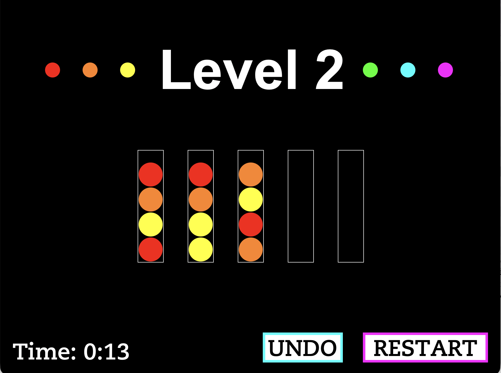

# sort-it-game
Ball sorting puzzle game built in Python

A ball sorting puzzle game built in Python. Move colored balls between tubes until every tube contains only one color.



## About

I built this as my semester project for COMP 1300 at Yeshiva University. The game has 10 levels that get progressively harder, with more colors and more tubes as you go.

## How to Play

1. Click a tube to pick up the top ball.
2. Click another tube to move the ball there. You can only place a ball on a matching color or in an empty tube.
3. Sort all the balls so each tube holds four balls of the same color.
4. Complete all 10 levels to win.

## Features

- 10 levels of increasing difficulty
- Undo button to reverse your last move
- Restart button to reset the current level
- Timer that tracks how long each level takes

## How It Works

- Each level is stored as a 2D list, where each inner list is a tube and balls are ordered bottom to top.
- A game loop handles mouse clicks, validates moves, and checks for a win after each move.
- Levels are deep-copied so they can be restarted without changing the original data.

## Running the Game

Requires Python 3 and the `Draw` graphics library from the course (not included in this repo).

```
python sort_it.py
```
